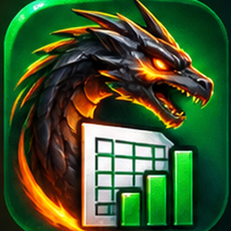

<p align="center"></p>

# Draco Sheets
Excel replacement as an responsive website. Caged Dragon Studios.

Engine: Univer (grid, formulas, formatting) · Shell: React + Vite · Cloud: Supabase · Offline: IndexedDB + service worker.

## Run
```bash
npm install
cp .env.example .env     # add Supabase URL + publishable key (optional: works offline without it)
npm run dev              # http://localhost:5173
npm run build && npm run preview
```
Cloud sync: `supabase/migrations/0001_sheets_init.sql` is already applied to the CAGED_DRAGON project (as migration `sheets_init`, 2026-11-05) (all tables, the function, trigger, indexes and policies are prefixed `sheets_`) (SQL editor or `supabase db push`), and enable Email and/or Google under Auth > Providers.

## Roadmap
`ROADMAP.md` lists v1–v100. After shipping versions, run `DONE=1,2,... PARTIAL=97 node scripts/gen-versions.mjs` to refresh the in-app Roadmap.
Icons: edit `public/icon.svg`, then `node scripts/make-icons.mjs`.

## Status (zip 16 / v1.2.0 — 100 versions built, partials being closed)
Test suites (all run against the real engine in headless Chromium unless noted):
- `tests/auto.test.ts`, `links.test.ts`, `a11y.test.ts`, `regional.test.ts`, `commands.test.ts`, `gallery.test.ts`, `assist.test.ts`, `parity-audit.test.ts` — pure-logic suites for v93-v100 (Node)
- `tests/v12-ui.py` — v0.12.0: 150,000-row Remove Duplicates (used to crash), Draco screens in Hindi/Tamil/French/Spanish/German/Arabic fallback
- `tests/xls.test.ts` (Node) and `tests/v11-ui.py` — v0.11.0: legacy .xls import, slicer/timeline move+resize, pivot field buttons, sparklines following row/column resizing
- `tests/adv-ui.py` — browser checks for macros, scripts, links, accessibility, large data, language, palette/shortcuts, templates/themes/assistant, parity self-test, phone layout
- `tests/parity.py` — 31 checks, v11-v25 formatting (incl. real-click UI)
- `tests/formulas.py` — 308 formulas across Excel's categories; 307 pass (1 known engine bug)
- `tests/formula-ui.py` — 25 checks: Name Manager, auditing, error checking, watch window, F2/F4, copy/paste refs, spill, 3D refs
- `tests/data-engine.py` — 25 checks of engine-native data tools: sort (multi-level, formulas follow rows), filters, find/replace, validation, freeze panes, autofill series, text-to-columns
- `tests/data-ui.py` — 30 checks of the new Data dialog with real clicks
- `tests/charts-ui.py` (62) and `tests/objects-ui.py` (26) — charts, sparklines, shapes, icons, diagrams and linked pictures with real clicks: insert, live refresh when cells change, save + reload, move/resize, delete
- `tests/chartmath.test.ts`, `tests/chartrender.test.ts`, `tests/objects.test.ts` — 56 + 119 + 97 Node unit tests (trendline fits, nice axes, histogram bins, treemap, every chart type's SVG, sparklines, shapes, diagrams, camera)
- `tests/pivot.test.ts` (100), `tests/query.test.ts` (67) — Node unit tests of the PivotTable engine (12 aggregations, 10 show-values-as, grouping, calculated fields, layouts, subtotals, top-N) and the query engine (20 transform steps, CSV/JSON parsing)
- `tests/pivot-ui.py` — 62 checks with real clicks: pivot create/update/refresh/delete, overwrite protection, slicers, timelines, PivotCharts, queries, save + reload
- `tests/files.test.ts` (129), `tests/files2.test.ts` (92), `tests/print.test.ts` (122) — Node unit tests: xlsx/ods/csv/json converters, number-format renderer, print layout + PDF writer (validated with poppler/qpdf), HTML clipboard parsing, version diff, sync queue
- `tests/files-ui.py` — 84 checks with real clicks: import/export round trips (also read back with openpyxl), drag & drop, print preview, PDF download, paste from Excel/Sheets, version history, crash recovery
- `tests/collab.test.ts` (146) — Node unit tests: comment threads/merge/anchor shifting, change log + revert planning, protection geometry + passwords, share-link codec, live-session protocol (join, snapshot, no echo, roles, presence expiry)
- `tests/collab-ui.py` — 68 checks with real clicks/typing: comments and markers (reload, row insert/delete), notes, change log + revert, protected sheets (real typing blocked/allowed, password, reload), share links, two-tab live sessions (snapshot, edits, formulas, formats, presence cursors, roles), phone layout
- `tests/audit.test.ts`, `tests/data.test.ts`, `tests/data2.test.ts` — 24 + 69 + 13 Node unit tests (no browser): reference parsing, circular detection, remove duplicates, Flash Fill, goal seek, consolidate, advanced filter, Go To Special, subtotals, table styles, text splitting

New in v0.5.0: **Data** dialog — Go To / Go To Special (blanks, constants, formulas, errors, last cell, multi-range selection), Remove Duplicates, Text to Columns (any delimiter, quotes), Flash Fill (learns patterns from examples), Advanced Filter (in place or copy), Subtotal / Remove All, Format as Table (6 styles), What-if (Goal Seek, data table, scenarios), Consolidate (by position or labels, across sheets).

New in v0.6.0: **Charts** dialog — 18 chart types (column, bar, line, area, pie, doughnut, scatter, bubble, radar, stock, combo with secondary axis, waterfall, funnel, histogram, box & whisker, treemap, sunburst, surface top-view), titles, legends, axis titles, data labels, gridlines, stacked/100%, log scale, trendlines (linear/exp/log/power/polynomial/moving average, forecast, equation, R²), error bars, 7 palettes, light/dark, quick styles, saved chart templates, live preview. Charts follow the data (re-drawn when source cells change) and are saved with the workbook. **Objects** dialog — sparklines (line/column/win-loss with high/low/first/last/negative markers), 15 shapes + text boxes, 24 icons, 10 SmartArt-style diagrams built from an outline (list, blocks, process, chevrons, cycle, org chart, pyramid, matrix, Venn, timeline), and live linked pictures of cell ranges.

New in v0.7.0: **PivotTable** dialog — build from any range (rows, columns, values, report filters; sum/count/average/min/max/product/stdev/var and more; show values as % of total/row/column/parent, running total, rank, difference; Compact/Outline/Tabular layouts; subtotals and grand totals; sort by label or value; top-N; automatic Years/Quarters/Months date grouping; numeric bins; calculated fields), live refresh when source cells change, **slicers** and **timelines** (click = only this item, ☑ toggles multi-select), **PivotCharts**. **Queries** dialog — Power-Query-lite: import from cells, pasted CSV/TSV, JSON or a URL, 20 transform steps (filter, split, merge, replace, dedupe, fill down, group by, unpivot, append, join, add column...), step list with reorder/delete, preview, load to sheet, auto-refresh. PivotTables and queries are saved with the workbook.

New in v0.8.0: **Files** dialog (Ctrl+P opens its print tab) — open .xlsx/.xlsm/.ods/.csv/.tsv/.json (also by drag & drop onto the page), download .xlsx/.ods/.csv/.tsv/.json (values, formulas with cached results, styles, number formats, merges, column widths, row heights, freeze panes, tab colours); **print layout** (paper sizes, orientation, margins, scale or fit-to-pages, print area, repeated title rows/columns, manual page breaks, gridlines, headings, centring, headers/footers with &P &N &D &T &F &A) with live page preview, print and **PDF download** (built in, no server); **paste from Excel / Google Sheets / web tables** with fonts, colours, borders, merges, number formats and formulas; **version history** (automatic checkpoints, named versions, compare with now, restore with a safety copy); **crash recovery** from autosaved drafts; offline queue that re-pushes cloud workbooks when back online.

New in v0.9.0: **Review** dialog (top bar, and the phone menu) — **comments** with threaded replies, resolve/reopen, edit/delete, filters, search, CSV export and a marker on every commented cell (anchors follow row/column inserts and deletes); **notes** (plain sticky notes with a list and CSV export); **Share & live** — start a live co-editing session (6-letter code or link, presence cursors with names, host-controlled roles: view / comment / edit) and create a self-contained share link (the workbook is packed into the link; opens as a view-only, comment-only or editable copy); **Changes** — who changed which cell (before/after), filters, CSV, revert selected; **Protect** — lock a sheet (optional password, choose what everyone may still do, ranges that stay editable) and protect the workbook structure.

New in v1.2.0: **Real Excel-style Tables** (Tools > Tables): name them, use `Table1[Sales]`, `Table1[[#Headers],[Sales]]`, `Table1[#Totals]`, `[@Units]` and bare `Table1` in formulas (resolved to live ranges that follow the table), the table grows when you type under it or beside the header, calculated columns fill down, a total row with per-column Sum/Average/Count/Min/Max/StdDev/Var, six styles, banded rows, filter buttons, rename (formulas follow), resize, convert to range, and **table slicers** (click to hide rows; ctrl/shift for several). The table list is saved inside the workbook. Formulas show as A1 references after you press Enter (the structured text is kept internally and re-applied when the table changes). **PWA removed**: Draco Sheets is now a plain website — no service worker, manifest or install prompt (a self-removing `sw.js` cleans up anyone who installed an earlier version). **New logo** used as favicon, top-bar logo and README header.

New in v1.1.0: **Trace arrows drawn on the grid** (Formulas > Auditing > Draw arrows on sheet; precedents or dependents, one level or all, dashed boxes around ranges, loops for self-references; other-sheet links are counted and listed). **Spill references** — type `=SUM(A1#)` and it becomes a live block over the contiguous cells starting at A1 (works for 1-D and 2-D spills and grows or shrinks with them). **Circle Invalid Data** (Formulas > Error checking): red rings around every cell that breaks its validation rule. Array maths without Ctrl+Shift+Enter, `@`, LET, LAMBDA and MAP were verified to work. Not built: manual calculation mode and iterative calculation (the engine has no switch for either).

New in v1.0.0: **Analysis ToolPak** (Tools > Analysis ToolPak): Descriptive Statistics, Correlation, Covariance, multiple Regression (coefficients, standard errors, t, p, 95% limits, ANOVA table), t-tests (paired, equal and unequal variance), z-test, F-test, single-factor ANOVA, Rank and Percentile, Moving Average, Exponential Smoothing, Histogram counts and Sampling — checked against textbook values. **Background worker** for Remove Duplicates and column statistics on big ranges (`dracoData.dedupeAsync`, `dracoData.stats`). **Server-enforced cloud share links** (migration `0002_sheets_shares.sql`, already applied to CAGED_DRAGON): view/comment/edit role, expiry and revoke are checked by the database; open with `#cloud=<token>`.

New in v0.13.0: **True 3-D surface chart** (isometric mesh with depth sorting, adjustable rotation and elevation, colour ramp) alongside the top-view surface, and **map charts** — US states and Indian states/UTs as tile maps, plus a world bubble map for ~50 countries; labels match by code or full name, case-insensitive, and unmatched labels are reported. Built-in data, no downloads. Chart dialog > Map / 3-D surface.

New in v0.12.0: **Big-data crash fixed** — operations that read a whole range (Remove Duplicates, Text to Columns, clipboard paste, consolidate, queries, pivots, sparklines and charts) crashed with a stack overflow above roughly 120,000 rows because they spread the rows into `Math.max(...)`; they now use loop-based `maxOf/minOf`, and large writes go in 20,000-row chunks. 150,000-row Remove Duplicates now runs in seconds. **Draco's own screens in more languages** — top bar, menus, statuses, dialog close buttons and the Tools/Review tabs are translated into **Hindi, Tamil**, French, Spanish and German (Tools > Language > Interface language; Hindi and Tamil translate Draco's screens only because Univer has no Hindi/Tamil pack, so the spreadsheet's own menus stay English). Other languages fall back to English for any string not yet translated.

### Known limits of v0.12.0
- Translated: top bar, phone menu, status text, Tools and Review tab names, dialog titles for those two, Close. The contents of the other dialogs (Charts, PivotTable, Data, etc.) are still English.
- No background worker for bulk edits yet: very large operations still run on the main thread (they no longer crash, but the page can pause for several seconds).

New in v0.11.0: **Slicers and timelines can be moved and resized with the mouse** — drag the title bar to move, drag the grip in the bottom-right corner to resize (a dashed outline shows where it will land). **PivotTable field buttons** — a ▾ appears in each row-field header and the column-field header on the grid; it opens a checklist of that field's items (with Select all) that filters the pivot, same as a slicer. **Sparklines stay glued to their cell** when rows or columns are resized, inserted or deleted. **Legacy .xls files now open** (Files dialog or drag & drop): values and number formats come across; formulas may arrive as their results, and fonts/charts/pictures from the old file are not kept.

### Known limits of v0.11.0
- Field buttons cover row fields and the first column field; page (report) filters and value-field settings are still in the PivotTable dialog. In compact layout only the first row field gets a button.
- Moving a slicer rebuilds it once when you let go (it does not follow the pointer live).
- .xls: password-protected files are not supported.
- Still open from the roadmap: map charts (v72), true 3-D surface charts (v64, drawn as a top view), cloud features untested until Supabase is connected, right-to-left grid drawing, Hindi UI pack, bulk-edit worker (v97).

New in v0.10.0: **Tools** dialog (top bar; phone menu; or press **Ctrl+/** / **Alt+Q** to search every command, **F1** for shortcuts). Tabs: **Macros** (record your edits, replay relative to the selected cell or absolute, saved in the workbook, convert to a script), **Scripts** (JavaScript with an async `draco` API, run in a sandboxed worker with a time limit and Stop button; examples included), **Links & web data** (web/email/sheet/cell/range/named-range links, broken-link check, web CSV/JSON/HTML-table connections with refresh), **Accessibility** (high contrast, reduce motion, strong focus, text size, screen-reader cell announcements, accessibility checker, skip link, focus-trapped dialogs), **Large data** (expand to Excel limits, chunked test data, benchmark), **Language** (Univer UI in 11 languages, regional number/date/currency formats, convert text like 1.234,56 or 31.12.2024), **Templates & themes** (6 templates, 7 themes, colour palettes, offline formula assistant: describe -> formula, explain, summarise), **Shortcuts**, **Parity report** (progress by phase, known gaps, 50-formula self-test).

### Known limits of v0.10.0
- Macros replay edits directly and cannot be undone with Ctrl+Z; only cell/format/structure edits are recorded.
- Scripts are async (`await` every call), run in a worker with no page, storage or network access.
- Web data connections are limited by the other site's CORS rules.
- The grid is drawn on a canvas, so screen readers get cell contents through the announcer, not the DOM.
- Large data: Excel's 1,048,576 x 16,384 limits are available, but very large fills use lots of memory; filling is chunked and cancellable.
- UI language covers Univer's menus and dialogs only (Draco's own screens are English; no Hindi pack; function names are not localised). Right-to-left sheets are stored in the file but this Univer build still draws the grid left to right.
- Shortcuts: Excel's common shortcuts are covered (native or Draco); the rest are reachable through the palette.
- The assistant is rule-based and offline, not an AI model; nothing leaves the device.
- Cloud sync, Realtime co-editing transport and share tokens are still untested until Supabase is connected.

### Known limits of collaboration (v0.9.0)
- Live sessions use last-writer-wins on cells: there is no operational transform, so two people typing in the same cell at once means the later edit wins. Only core sheet edits are shared live (values, formulas, formats, rows/columns, merges, sheet add/remove/rename); conditional formats, validation, filters and Draco objects (charts, pivots, queries) sync when a guest presses Resync or rejoins. Comments merge between peers.
- Sessions work between browser tabs/windows on one device out of the box. Across devices they need the Supabase Realtime transport, which is written but untested until Supabase is connected.
- Roles and sheet protection are enforced in the client, like Excel's: they stop accidents and casual edits, not a determined person with developer tools. Passwords are hashed with salt but protection is not encryption.
- A share link carries the whole workbook, so very large workbooks (over about 180 KB of link) need a file or a live session instead; links can't be revoked once sent.
- The change log records cell edits (not formatting or structure) and skips bulk edits above 5,000 cells; it keeps the latest 3,000 entries.

### Known limits of files/print (v0.8.0)
- Legacy binary .xls can't be opened (re-save as .xlsx); macros in .xlsm are dropped (a warning is shown). Conditional formats, data validation, pictures and charts inside imported files are not imported; charts/objects are not exported to xlsx/PDF yet.
- PDF uses the built-in Helvetica fonts: characters outside Western European text print as "?". Cell fonts other than Helvetica are approximated in the PDF.
- The printed page comes from Draco's own layout engine, so page breaks can differ slightly from Excel's. Row/column heights are the sheet's, text rows don't auto-grow for wrapped text in print.
- Paste-from-Excel is a dialog (copy, then paste into its box); normal Ctrl+V in the grid uses the engine's own paste. Google Sheets formulas arrive as values.
- Cloud sync queue is implemented but untested until Supabase is connected.

### Known limits of PivotTables/queries (v0.7.0)
- No drag-and-drop field list (use the Add field picker); no drill-down by double-click; no pivot field buttons on PivotCharts; PivotTable output is written as plain cells (not an Excel pivot object) so it won't export as a native pivot in xlsx (v79).
- Slicers/timelines can't be dragged or resized with the mouse (use Manage); modifier-click isn't reliable over the sheet, so use the ☑ multi-select toggle.
- URL queries only work when the server allows browser (CORS) access; otherwise paste the data. Queries on pasted/URL sources refresh on demand only.

### Known limits of charts/objects (v0.6.0)
- Charts and objects can't be dragged or resized with the mouse (engine limitation for runtime overlays): use Charts > Manage / Objects > Manage to resize and "Move to cell".
- Sparklines don't follow when you resize their row/column afterwards; re-create them. Chart/objects are not yet included in print/PDF/xlsx export (v79-v82).
- Surface chart is a top-view heat grid, not 3-D. No map charts. Images: insert uses the engine's own Insert > Image (not covered by Draco tests). Chart elements can't be formatted one by one (only through the dialog options).

### Known engine discrepancies vs Excel
- `DOLLAR()` returns a trailing space (`"$1,234.50 "`). Function overrides are ignored by the engine, so this can't be patched from the app.
- Spill-reference operator `A1#` is unsupported (`=SUM(A1#)` -> `#VALUE!`).
- Formula cells that get an auto number format (dates, currency) report their display text through the API instead of the number (calculation itself uses the number). Matters for v79 xlsx export - must be tested there.
- Default date format is `yyyy/mm/dd`; Excel en-US shows `m/d/yyyy`.
- Deleting a defined name gives `#REF!` in dependents (Excel: `#NAME?`).
- Circular references evaluate to 0 silently; Draco flags them in Formulas > Error checking.
- No Show Formulas view, no Evaluate Formula stepper, no manual-calculation mode, no iterative calculation.

- No row/column outline (grouping), no split panes, no table structured references or slicers, no Solver, no Scenario Summary, no "circle invalid data".
- Flash Fill learns word/character-position/case patterns from examples; it does not do date reformatting or fuzzy extraction.
- Goal Seek / data tables recalculate the sheet once per try (each ~0.1-0.3 s), so they are slower than Excel's.

### Roadmap state
Done: v1-v6, v10-v39, v41, v42, v46, v48-v51, v53, v54, v59, v61-v63, v65-v68, v71, v73, v74, v76, v79-v82, v84-v88, v91-v96, v99, v100 (v69, v75, v77, v83 closed in v0.11.0). Partial: v97, v98, v7-v9 (cloud untested - Supabase not connected), v40, v43-v45, v47, v52, v55-v58, v60, v64 (surface is top-view), v69 (sparklines don't follow row/col resize), v70 (images untested), v72 (no map charts), v83 (no .xls), v75 (slicers/timelines: no mouse move/resize), v77 (no pivot field buttons), v78 (URL sources limited by CORS), v97, v89 (live co-editing: BroadcastChannel tested between browser tabs; Supabase Realtime transport untested), v90 (share by self-contained link and session link; roles are client-side only).

## Known limits
- 100,000 rows x 10 cols + a formula per row recalculates in ~20 s (20,000 rows: < 1 s, UI stays responsive).
